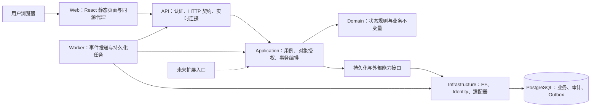

# MESagent 功能实现架构 v0.4

更新：2026-11-13｜状态：F1～F4 基础及 F5-01～05 已落地，F3 真实进度/F2 执行绑定已回补；完整 F6/F7 待后续｜需求入口：[Fab 功能清单](07-fab-function-catalog.md)

当前实现进度见 [F1 实现说明](../feature-development/organization-identity-access-control-implementation.md)及 [F2/F3 实现记录](../feature-development/f2-f3-implementation.md)。本文延续既有分层，并在第 11 节补充 F4 与生产模块的协作设计；F4 的当前实现与边界见[本地验收](../feature-development/lot-wafer-carrier-genealogy-implementation.md)。Docker 打包继续后置。

## 1. 本轮结论与依据

以**模块化单体、共享应用服务、单 PostgreSQL 数据库、同源 React WebUI**承接功能目录。先完成 F1-`OrganizationIdentityAccessControl` 与必要的 F12-`ApplicationAuditReliability`/F14-`DockerDeliveryAcceptance` 基础，再按工艺、生产、质量、追溯的依赖逐步交付。模块是代码与业务责任边界，不按每个功能 ID 拆成独立服务。

| 类别 | 本轮基线 |
| --- | --- |
| 已实现 | Domain/Infrastructure/Database、Application/API/WebUI；F1 01～04、F2 01～05、F3 工单与真实片进度、F4 基础/真实终点、F5 01～05 和最小设备前置；119 张业务/支撑表、7 张 Identity 表、2 个视图 |
| 用户已确认 | 单企业单厂、同源 Cookie、本地账号、角色及厂区授权；F1 01～04 完整设计、05/06 扩展；F4 01～06 文档范围、工单建批及受限拆合批，具体见第 11 节 |
| 本文设计方案 | 项目职责、模块协作、授权位置、事务与交付顺序；用于后续实现，不表示已通过运行验证 |
| 待实现/验证 | 完整 F6 质量/报废/异常恢复、完整 F7 资源、F5 按需能力、实时通知及 Docker；部分报废后的跨模块联调与复杂存量专项仍待，容量与恢复目标另定 |

历史依据为 [系统规划](02-system-plan.md)、[技术选型](03-tech-stack.md)、[数据架构](../MESagent-development-guide.md) 和现有代码。旧文档中的“未建库”是当时状态，当前事实以代码、数据库实施记录和 MEMORY 为准。Agent 本轮仅保留未来调用 Application 的扩展位置，F13-`AgentWorkbench` 暂不展开，也不作为本轮功能设计的前置条件。

## 2. 运行架构

图中箭头表达运行调用。API 和 Worker 共享应用规则；Worker 到 API 的路径用于投递通知，具体内部契约在 F12-04 实现时验证。数据库事务提交成功才允许通知。F1-`OrganizationIdentityAccessControl` 可先通过 HTTP 刷新完成，不依赖实时基础设施。

部署保持 Web/API/Worker/PostgreSQL 四个职责，Worker 在有实际任务时启用。迁移通过独立一次性部署任务执行，API 启动不自动改库。初期不增加 Redis、消息中间件或 Kubernetes。

## 3. 工程组织与依赖

| 路径 | 状态 | 职责 |
| --- | --- | --- |
| `src/MESagent.Domain` | 已有，待补行为 | 纯业务对象、状态转换、值与集合约束；不依赖 HTTP、EF、Identity |
| `src/MESagent.Application` | 已有，随 F4 扩展 | 按模块放命令、查询、DTO、验证与能力接口；定义用例入口、授权和事务边界 |
| `src/MESagent.Infrastructure` | 已有，待扩展 | 实现 Application 接口，承载 Identity、EF、查询投影、事务和外部适配 |
| `src/MESagent.Api` | 已有，随 F4 扩展 | `/api/v1`、Cookie、防伪、端点、ProblemDetails、依赖注入；不在控制器内写业务流程 |
| `src/MESagent.Worker` | 按任务需要创建 | Outbox 消费、重试、后台导出或导入；不能直接绕过应用规则更新业务表 |
| `src/MESagent.Database` | 已有 | 迁移、字典导出；增加受控初始化命令时与业务启动分开 |
| `src/MESagent` | 已有 | 保留原控制台骨架 |
| `web/` | 已有 | React/TypeScript/Vite/Ant Design；路由、页面、查询缓存、生成的 API 客户端 |
| `tests/` | 部分已有 | 保留真实数据库测试，按用例补应用/API/UI 测试 |
| `deploy/` | 已有草案，交付后置 | 应用镜像、反向代理、运行配置及交付说明；复用现有数据库 Compose 基础 |

编译依赖为 Application → Domain；Infrastructure → Application + Domain；Api/Worker → Application，并在组合入口引用 Infrastructure 注册实现；Database → Infrastructure。Domain 不反向引用其它层，Application 不引用 Infrastructure 中的 `MesUser`、DbContext 或 EF 类型。

Application 的接口按实际用例定义，例如当前操作者、对象范围解析、身份管理、组织查询、事务与审计。不为每张表机械创建 CRUD 服务，也不强制引入通用 Repository、Mediator 或独立读库。查询可由 Infrastructure 直接投影 DTO；复杂写用例加载领域对象并显式组织事务。

每层内部按模块建目录，共用库只放确实跨模块使用的类型。先维持现有单一 MesDbContext，避免拆 Context 后丢失跨模块原子事务。

## 4. 功能目录与模块责任

| 功能 | 应用模块 | 数据归属与主要协作 |
| --- | --- | --- |
| F1-`OrganizationIdentityAccessControl` | Organization、AccessControl | organization/security；向全部模块提供操作者、权限、厂区范围及组织有效性 |
| F2-`ProductProcessVersionManagement` | Engineering | engineering；发布工艺版本、产品与配方；向生产提供只读版本与适用性规则 |
| F3-`WorkOrderPlanningExecution` | Planning | production 工单相关表；下达、变更、进度；与工艺及 Lot 协作 |
| F4-`LotWaferCarrierGenealogy` | LotManagement | production 中 Lot/Wafer/载具/血缘；数量、归属、装载及收尾 |
| F5-`DispatchAndProductionExecution` | Execution | production 中步骤/Run/Track；编排质量门禁、设备占用及工艺版本校验 |
| F6-`QualityExceptionDisposition` | Quality | quality；异常、Hold、检验、报废；涉及晶圆归属/装载时在同一事务调用对应业务能力 |
| F7-`EquipmentMaintenanceResources` | Equipment | equipment；设备、状态、停机、资格、维护；提供可加工性与占用相关能力 |
| F8-`MaterialConsumptionInventory` | Materials | materials；来料、耗用与库存；账本权威源未定的能力不提前上线 |
| F9-`TraceabilityImpactAnalysis` | Traceability | 跨域只读投影；从各域事实构建履历，不自建可编辑的另一份生产事实 |
| F10-`WorkbenchDashboardsAlertsScheduling` | Workbench、Reporting | 跨域只读工作台、待办与指标；排程、订阅等扩展另立模型 |
| F11-`DataImportEquipmentIntegration` | Integration | integration；导入、模拟事件、外部适配；解析后调用应用用例 |
| F12-`ApplicationAuditReliability` | SharedApplication、Audit、BackgroundJobs | audit 与公共管线；幂等、事务、审计、事件、附件、可观测性 |
| F13-`AgentWorkbench` | 预留 | 本轮不展开设计与实现 |
| F14-`DockerDeliveryAcceptance` | Delivery、Verification | Docker、初始化、测试与恢复；不是业务 CRUD 模块 |

跨模块读可以按已定义的只读契约组合。写入由拥有该业务能力的模块负责；跨模块原子操作由顶层用例协调，同一 DbContext/事务提交。不能让设备事件适配器自行改 Lot，也不能让统计页面覆盖业务数量。

## 5. 一次请求如何执行

### 5.1 查询

认证与会话检查 → 查询权限检查 → 服务端解析对象厂区/部署范围 → 在数据库查询中限制范围 → 分页、统计及 DTO 投影 → 返回结果。

范围过滤必须在计数、聚合、联表、分页和导出之前完成。直接按 ID 查详情、附件、审计、幂等回执同样校验来源对象范围。客户端传入的 FabId 只表达查询意图，不授予访问权。

### 5.2 写命令

认证与防伪校验 → 输入验证 → 开启事务 → 读取当前权限、范围及对象状态 → 幂等核对（适用时）→ 版本/锁校验 → 领域规则 → 业务变化、审计、必要事件与回执 → 提交 → 响应。

API 的端点权限是第一道检查；Application 的用例授权是最终业务入口，不能仅靠按钮或 `[Authorize]` 标记。对象授权需要结合加载后的资源信息，框架提供资源授权入口；具体厂区和动作规则由本项目定义。参见 [ASP.NET Core 资源授权](https://learn.microsoft.com/en-us/aspnet/core/security/authorization/resource-based?view=aspnetcore-10.0)。

| 场景 | 必须同事务处理 | 并发重点 |
| --- | --- | --- |
| 组织资料更新 | 主数据变更、审计 | xmin；停用前复核依赖；归属不随意迁移 |
| 用户角色/范围修改 | Identity 关系、会话撤销、审计 | Identity 并发戳；防止并发移除最后管理员 |
| Track-in/out | Lot/步骤/Run/实际 Wafer/设备占用、审计、事件、回执 | 锁定或校验共享资源；既有唯一约束兜底 |
| 拆批/合批 | 血缘、逐片归属、源/目标状态、审计与回执 | 一致顺序锁定 Lot/Wafer；片集合守恒 |
| 报废 | 逐片处置、归属、装载、数量快照、审计与回执 | 核对待处置片与加工状态；失败全部回滚 |

生产流程表仅确定架构责任，详细状态机在对应功能文档中冻结。不要把表中的事务组合当成已实现用例。

### 5.3 幂等、并发与事件

- 普通修改使用 `If-Match`/ETag；业务实体版本来源为 xmin，Identity 对象使用并发戳并保证关联授权变化也推进版本。缺少条件返回 428，过期返回 412，状态冲突返回 409。
- 建批、过站、拆合批、报废等命令使用 `Idempotency-Key`。作用域绑定用户、操作、厂区；哈希覆盖规范化业务载荷。同键同参重放已授权结果，同键异参返回 409；权限撤销后不得凭旧回执绕过查询授权。
- Identity 的登录、密码变更与重置不进入保存请求/响应的通用回执机制，避免持久化凭据；使用专门状态和版本处理，前端不自动重试。F1-`OrganizationIdentityAccessControl` 另行定义。
- 更新与竞争以数据库事务、版本和明确锁策略为准；禁止“先查无冲突再无条件写入”。可重试的数据库瞬时失败须从整个用例重跑，不能在已回滚的事务内继续操作。
- Outbox 与业务同事务落库；消费者按至少一次投递实现去重、退避、最大重试和人工重放。已有表尚缺租约/消费去重/死信等完整运行契约，F12-04 开发前补齐。
- F1-`OrganizationIdentityAccessControl` 写操作首先保证业务与审计原子提交；有消费者时才定义并写入业务事件，不为每次读取强行生成 Outbox。

## 6. 权限与厂区边界

角色聚合可执行动作，`UserFabScope` 限定可访问厂区，两者必须同时满足。未分配范围不等于全厂可见；管理员也不自动获得所有生产动作。单厂部署通过明确的 `DeploymentFabId` 收敛可用厂区，而不是把所有对象都视为无范围数据。

当前有些对象直接带 FabId，有些需沿 Area/工单/Lot 等关系解析，还有工艺定义等实例级共享数据。每个新模块须列出范围解析规则；实例级共享数据在本轮只对具有部署厂区范围的用户开放，多厂启用前必须重新决定共享、复制或厂区归属。

当前并非所有跨对象外键都能防止跨厂关联。既有数据库中的 `UserFabScope` 不代表 RLS 或完整隔离已实现；应用必须检查全部相关对象同厂，关键约束再通过迁移加固。未来多厂角色需独立的用户—角色—厂区关系，不能把现有全局角色集合与多个 Fab 范围简单相乘。

审计、附件、后台导出及实时订阅继承来源对象权限。没有可解析来源的组织级安全管理数据仅限明确的安全管理权限。内部任务使用明确任务身份及限定范围，不伪造人的 UserId。

## 7. WebUI 与接口约定

前端沿用 React 19、TypeScript、Vite、Ant Design 6、React Router、TanStack Query 的既有方案，具体版本沿用现有锁文件，本轮不升级依赖。菜单按业务任务分组：基础与权限、工艺、计划、生产、质量、设备、物料、追溯、看板；不能直接展示数据库表菜单。

- OpenAPI 是 HTTP 契约来源，生成 TypeScript 客户端；请求 DTO 白名单映射，防止客户端修改身份、厂区归属、审计等受控字段。
- 列表默认分页 20，最大 100；排序字段白名单，稳定次序含 ID；统一返回 `items/total/page/pageSize`。时间存 UTC，界面按 Fab 时区显示并标注。
- 错误统一 ProblemDetails，附 `code/traceId/errors`；401 登录失效，403 动作被拒，404 不存在或不可见，409 业务状态冲突，412 版本过期，428 缺少版本，429 限流。
- `GET` 不修改业务；使用 Cookie 的写请求含防伪令牌。API 返回状态码与 JSON，不向 SPA 返回登录页 HTML。Cookie、防伪和撤权实现见 F1-`OrganizationIdentityAccessControl`。
- 用户/厂区切换和退出时清空查询缓存；按钮显隐使用服务端能力信息，提交仍由服务端重新校验。处理加载、空数据、失败、权限不足和并发冲突。
- SignalR 初期只发送获授权的变更提示，客户端重新查询；订阅和发送时检查权限，撤权关闭相关订阅，重连后取快照。连接分组名称不是安全边界。

## 8. Docker 与运维责任

复用现有 PostgreSQL 镜像和独立数据卷；API/Worker 使用最小权限运行账号，迁移另用 DDL 账号。Web 同源代理 `/api` 与后续实时连接，HTTPS 在部署入口终止，禁止将数据库公开到公网。

Cookie Data Protection 密钥持久化并在需要的 API 实例间共享；数据库、密钥、附件一起纳入恢复。密钥通过部署环境注入，不写文档或默认演示账号。备份恢复目标与性能数字仍待现场要求确定，本轮不承诺高可用。

F1-`OrganizationIdentityAccessControl` 首次初始化由显式命令创建部署 Fab、受保护管理员角色及首个管理员；与迁移区分，已有管理员时拒绝重复引导。后续发布不能覆盖人工授权配置。

## 9. 实施顺序与完成门槛

| 阶段 | 交付范围 | 完成门槛 |
| --- | --- | --- |
| A：F1-`OrganizationIdentityAccessControl` 基础闭环 | Application/API/WebUI、组织/账号/角色/范围/会话，必要的 F12-`ApplicationAuditReliability` 审计与错误处理，最小 F14-`DockerDeliveryAcceptance` 初始化交付 | 两类账号登录、组织维护、越权拒绝、撤权失效、重启保持登录验证能力；见 F1-`OrganizationIdentityAccessControl` 验收 |
| B：业务准备 | F2-`ProductProcessVersionManagement` 工艺版本、F7-`EquipmentMaintenanceResources` 设备基础、F8-`MaterialConsumptionInventory` 来源，F3-`WorkOrderPlanningExecution` 工单 | 可发布工艺并准备可追溯的设备/物料/工单样本 |
| C：生产与质量 | F4-`LotWaferCarrierGenealogy` 批次/载具、F5-`DispatchAndProductionExecution` 执行、F6-`QualityExceptionDisposition` Hold/检验/报废；补齐幂等与 Outbox | 5 片、3 步演示；叠加 Hold、拆合批守恒、重复提交与并发验证 |
| D：可视与追溯 | F9-`TraceabilityImpactAnalysis`、F10-`WorkbenchDashboardsAlertsScheduling` 核心、F11-`DataImportEquipmentIntegration` 模拟事件 | 查询下钻到同一生产事实；范围过滤覆盖统计与导出 |
| E：完整交付 | F14-`DockerDeliveryAcceptance` 全链路、备份恢复、部署演练 | 空环境部署、真实 API/UI 验收、带业务数据恢复 |

按需能力只有在相关工艺明确依赖时前移；ShiftsAndHandovers/06、真实设备、复杂排程等保持独立启用门槛。上述顺序不构成日历工期或额外开发授权。

每个功能文档按需求 ID 链接：范围 → 页面/流程 → 规则与权限 → 数据差异 → API → 验收。数据库结构、API、UI 都通过验收后才把功能标记为已实现。

## 10. 功能文档入口

[F1-`OrganizationIdentityAccessControl` 组织、身份与访问控制](../feature-development/organization-identity-access-control.md) 是本架构的首个落点。后续已有 F2/F3 文档与实现记录，本轮进入 [F4 功能设计](../feature-development/lot-wafer-carrier-genealogy.md)及[接口与验收](../feature-development/lot-wafer-carrier-genealogy-api-and-acceptance.md)。继续以功能目录为需求索引，不复制 OpenMES 文档作为实现说明。

## 11. F4 生产功能的实现架构

### 11.1 本轮确认与现状差异

2026-11-11 用户确认 F4-01～06 完整文档设计，F4-07 及无工单工程批预留；建批必须关联已下达工单；拆合批仅非加工中、无有效 Hold，合批同厂、同工单、同产品修订、同路线版本及同工艺位置。该次任务仅编写文档；2026-11-12 后续代码实施见第 11.4 节。

现有 Application/API 已落地，但制造模块实际复用了身份模块命名的请求与后端入口，并通过 `ManufacturingBackend` 分派工程/工单用例。已有事务内全局写锁，尚非按生产聚合细分的锁；现有幂等摘要使用原始 JSON。F4 在该运行基础上扩展类型化用例、规范化回执和聚合版本，不能把本文件的目标分层当成全部已有实现。

### 11.2 模块协作与事务所有权

F4 模块代码使用 `LotWaferCarrierGenealogy`，负责身份、成员、载具及血缘；F5 负责步骤推进、实际 Run 和 Track；F6 负责 Hold、质量与报废处置。模块之间通过同进程应用契约协作，共用一个数据库事务，禁止互调 HTTP 后各自提交。

| 顶层用例 | 必须协调的能力 | 同事务产物 |
| --- | --- | --- |
| 建批 | F3 已下达工单/快照、F2 编号、F4 登记 | Lot/Wafer、Create 血缘、成员、审计/事件/回执 |
| 投放 | F3 额度及状态、F2 绑定版本、F4 初次投片、F5 等待步骤能力 | 首次投放事实、Active Wafer、Ready Lot、首站 Waiting 步骤 |
| 拆合批 | F4 集合/兼容性、F5 等待位置继承、F6 阻塞查询 | 血缘、旧/新归属、源/目标步骤与状态、继承关系 |
| 装卸/移位 | F4 当前归属及占用、F1 位置、F5/F6 阻塞 | 装载时间区间或位置移动、聚合版本、审计/事件/回执 |
| 终点 Track-out | F5 真实加工与门禁、F4 唯一完成、F3 进度 | Run/步骤收尾、逐片完成事实、批次状态与工单缓存 |
| 报废 | F6 逐片处置、F4 成员/装载、F3 归属口径 | 报废/处置、关闭成员/装载、必要批次收尾及进度 |

F4 先实现等待步骤的最小共享能力，F5 再接管执行。F4 不提供人工“完成”接口。生产关键事实和缓存必须在同步事务内一致；Outbox 仅用于后续通知或非权威投影，未有消费者时不阻塞本地基础流程。

### 11.3 数据、并发与跨模块回补

逐片稳定工单/厂区、首次投放、终点完成、等待步骤继承、载具尺寸和独立收尾时间均需按 F4 数据差异表补充。现有归属视图只表示成员与报废数，完成片可保留最终成员，因此不能直接拿该视图当 WIP。工单指标从唯一 Wafer 事实聚合，拆合批不重复投放或产出。

首版保留所有现有写入口共用的全局事务锁；未来拆锁必须统一授权协调、工单/Lot/Carrier/Wafer/步骤及编号资源的顺序，并回归 F1 撤权、F2 废止、F3 关闭、F5 加工、F6 Hold/报废的竞争场景。子对象变化必须推进相关聚合版本，查询与预览不替代提交时重验。

新增模块使用带 Fab/用户/动作/目标作用域的回执、规范化载荷摘要与多对象版本；血缘的全局唯一键存服务端命令 ID，不直接复用局部客户端键。业务事实、审计、事件和回执一次提交；重放先复核当前授权再返回历史结果。

按以下门槛推进，均为后续实施计划：

1. F4 基础：身份/范围与迁移、建批取消、载具、投放等待、受限拆合批及查询验收。
2. F5/F6 协作：真实 Run、门禁、终点完成、报废收尾及竞争测试；记录尚缺能力。
3. 返回 F3 完成 GAP-01：真实投放/在制/阻塞/完工、缓存重算与工单关闭；同时回补 F2 GAP-06 执行绑定。
4. 再按授权推进通知、只读 Agent 和 Docker；不能把 F4 文档完成或表结构存在记作完整生产交付。

### 11.4 2026-11-12 实施结论

已判断仅需微调，并按第 11 节落地独立 `ProductionBackend`、Application 类型请求、Domain 规则及三个追加事实表。认证入口继续协调既有全局事务锁，F4 分文件处理 Lot/血缘/载具/查询/内部收尾；无新增服务、DbContext 或消息设施。

F4 作用域摘要适配现有回执字段，载荷规范化与旧版本重放已验证；F2/F3 旧回执机制保留兼容。生产写入使用最小权限运行角色，本地 serve 同步改用该角色。迁移、56 项数据库/API 测试和浏览器基础闭环已通过；当前字段字典为 126 张应用表。

F4-06 的 `CompleteAtRouteEnd` / `CloseMembershipForScrap` 已作为内部能力实现和测试，需 F5/F6 在同一授权事务内接入。工单真实进度及完整质量语义仍待回补，不通过公开完成接口或测试夹具冒充生产联调。具体覆盖见 [F4 实现记录](../feature-development/lot-wafer-carrier-genealogy-implementation.md)。

## 12. F5 执行架构（2026-11-13 确认）

用户确认 F5-01～05 文档/API/WebUI/测试、最小设备台账/人工状态/占用；完整 F7 与 F6 处置及返工另列 GAP-12～14。实现沿用现有认证事务管线，新增独立 ExecutionBackend，类型请求置于 Application，规则置于 Domain；不继续将 Run 用例加入工程后端。设备最小能力与执行共享事务，后续完整 F7 可提取实现，保持公开契约。

Track-in 在全局写锁内校验当前 Lot/Step/片集/设备/工单快照 Recipe 与已启用门禁，固定一次实际加工。正常 Track-out 校验作业记录、逐片结果及阻塞；全通过时复用 F4 等待步骤/终点收尾，异常则关闭 Run 并保留待处置步骤，不伪造重试。运行占用以 ProcessRun 为权威，人工设备状态不能覆盖占用。

F3 指标回补直接读取稳定逐片事实，ProducedQty 仅为可重算缓存；关闭/取消复用全局写锁检查当前生产关联。F2 输出/点检取冻结 RouteStep，PDF 与适用 Recipe 取工单下达快照，记录实际使用版本。跨模块授权与事实同事务提交，现有 F6 阻塞读取和完整质量处置覆盖分开显示。

详细规则与验收见 [F5 功能设计](../feature-development/dispatch-and-production-execution.md)及[接口与验收](../feature-development/dispatch-and-production-execution-api-and-acceptance.md)。本文新增部分为已确认范围与实现方案，测试证据完成后更新实现记录。

实施结果：上述独立执行模块、共享 F4 步骤/终点、F3 实际进度及 F2 执行绑定已实现；第 7 条迁移与最小运行角色增量授权已应用。普通只读请求使用一致性快照，写请求保持全局锁内重验。API、迁移与 Chrome 验证见 [F5 实现记录](../feature-development/dispatch-and-production-execution-implementation.md)，未将 F6/F7 预留表结构标为业务完成。
