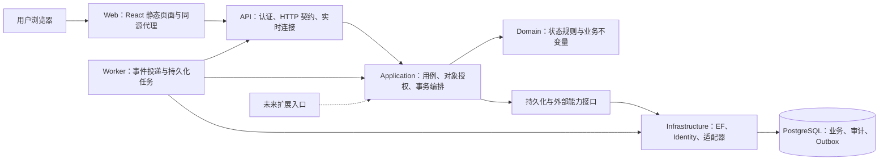

# MESagent 功能实现架构 v0.1

日期：2026-11-11｜状态：设计基线；OrganizationIdentityAccessControl 架构已落地｜需求入口：[Fab 功能清单](07-fab-function-catalog.md)

当前实现进度见 [OrganizationIdentityAccessControl 实现说明](../feature-development/organization-identity-access-control-implementation.md)。本文保留设计时的现状与目标分层；Docker 打包已由用户明确后置。

## 1. 本轮结论与依据

以**模块化单体、共享应用服务、单 PostgreSQL 数据库、同源 React WebUI**承接功能目录。先完成 OrganizationIdentityAccessControl 与必要的 F12/F14 基础，再按工艺、生产、质量、追溯的依赖逐步交付。模块是代码与业务责任边界，不按每个功能 ID 拆成独立服务。

| 类别 | 本轮基线 |
| --- | --- |
| 已实现 | Domain 实体、Infrastructure/Identity/EF 映射、Database 迁移工具、数据库测试；114 张业务表、7 张 Identity 表、2 个视图 |
| 用户已确认 | 单企业单厂先落地，保留厂区校验；组织结构、人员与场所、账号会话及角色权限 完整设计；05/06 仅扩展边界；本地账号密码、同源 Cookie、管理员建号/重置、首登改密、角色授权与厂区范围，个人直接授权暂不开放 |
| 本文设计方案 | 项目职责、模块协作、授权位置、事务与交付顺序；用于后续实现，不表示已通过运行验证 |
| 待验证 | 前后端工程、认证与撤权、跨模块事务、实时通知、Docker 应用交付；容量与恢复目标另行确定 |

历史依据为 [系统规划](02-system-plan.md)、[技术选型](03-tech-stack.md)、[数据架构](../MESagent-development-guide.md) 和现有代码。旧文档中的“未建库”是当时状态，当前事实以代码、数据库实施记录和 MEMORY 为准。Agent 本轮仅保留未来调用 Application 的扩展位置，F13 暂不展开，也不作为本轮功能设计的前置条件。

## 2. 运行架构

图中箭头表达运行调用。API 和 Worker 共享应用规则；Worker 到 API 的路径用于投递通知，具体内部契约在 F12-04 实现时验证。数据库事务提交成功才允许通知。OrganizationIdentityAccessControl 可先通过 HTTP 刷新完成，不依赖实时基础设施。

部署保持 Web/API/Worker/PostgreSQL 四个职责，Worker 在有实际任务时启用。迁移通过独立一次性部署任务执行，API 启动不自动改库。初期不增加 Redis、消息中间件或 Kubernetes。

## 3. 工程组织与依赖

| 路径 | 状态 | 职责 |
| --- | --- | --- |
| `src/MESagent.Domain` | 已有，待补行为 | 纯业务对象、状态转换、值与集合约束；不依赖 HTTP、EF、Identity |
| `src/MESagent.Application` | 待建 | 按模块放命令、查询、DTO、验证与能力接口；定义用例入口、授权和事务边界 |
| `src/MESagent.Infrastructure` | 已有，待扩展 | 实现 Application 接口，承载 Identity、EF、查询投影、事务和外部适配 |
| `src/MESagent.Api` | 待建 | `/api/v1`、Cookie、防伪、端点、ProblemDetails、依赖注入；不在控制器内写业务流程 |
| `src/MESagent.Worker` | 按任务需要创建 | Outbox 消费、重试、后台导出或导入；不能直接绕过应用规则更新业务表 |
| `src/MESagent.Database` | 已有 | 迁移、字典导出；增加受控初始化命令时与业务启动分开 |
| `src/MESagent` | 已有 | 保留原控制台骨架 |
| `web/` | 待建 | React/TypeScript/Vite/Ant Design；路由、页面、查询缓存、生成的 API 客户端 |
| `tests/` | 部分已有 | 保留真实数据库测试，按用例补应用/API/UI 测试 |
| `deploy/` | 待建 | 应用镜像、反向代理、运行配置及交付说明；复用现有数据库 Compose 基础 |

编译依赖为 Application → Domain；Infrastructure → Application + Domain；Api/Worker → Application，并在组合入口引用 Infrastructure 注册实现；Database → Infrastructure。Domain 不反向引用其它层，Application 不引用 Infrastructure 中的 `MesUser`、DbContext 或 EF 类型。

Application 的接口按实际用例定义，例如当前操作者、对象范围解析、身份管理、组织查询、事务与审计。不为每张表机械创建 CRUD 服务，也不强制引入通用 Repository、Mediator 或独立读库。查询可由 Infrastructure 直接投影 DTO；复杂写用例加载领域对象并显式组织事务。

每层内部按模块建目录，共用库只放确实跨模块使用的类型。先维持现有单一 MesDbContext，避免拆 Context 后丢失跨模块原子事务。

## 4. 功能目录与模块责任

| 功能 | 应用模块 | 数据归属与主要协作 |
| --- | --- | --- |
| OrganizationIdentityAccessControl | Organization、AccessControl | organization/security；向全部模块提供操作者、权限、厂区范围及组织有效性 |
| F02 | Engineering | engineering；发布工艺版本、产品与配方；向生产提供只读版本与适用性规则 |
| F03 | Planning | production 工单相关表；下达、变更、进度；与工艺及 Lot 协作 |
| F04 | LotManagement | production 中 Lot/Wafer/载具/血缘；数量、归属、装载及收尾 |
| F05 | Execution | production 中步骤/Run/Track；编排质量门禁、设备占用及工艺版本校验 |
| F06 | Quality | quality；异常、Hold、检验、报废；涉及晶圆归属/装载时在同一事务调用对应业务能力 |
| F07 | Equipment | equipment；设备、状态、停机、资格、维护；提供可加工性与占用相关能力 |
| F08 | Materials | materials；来料、耗用与库存；账本权威源未定的能力不提前上线 |
| F09 | Traceability | 跨域只读投影；从各域事实构建履历，不自建可编辑的另一份生产事实 |
| F10 | Workbench、Reporting | 跨域只读工作台、待办与指标；排程、订阅等扩展另立模型 |
| F11 | Integration | integration；导入、模拟事件、外部适配；解析后调用应用用例 |
| F12 | SharedApplication、Audit、BackgroundJobs | audit 与公共管线；幂等、事务、审计、事件、附件、可观测性 |
| F13 | 预留 | 本轮不展开设计与实现 |
| F14 | Delivery、Verification | Docker、初始化、测试与恢复；不是业务 CRUD 模块 |

跨模块读可以按已定义的只读契约组合。写入由拥有该业务能力的模块负责；跨模块原子操作由顶层用例协调，同一 DbContext/事务提交。不能让设备事件适配器自行改 Lot，也不能让统计页面覆盖业务数量。

## 5. 一次请求如何执行

### 5.1 查询

认证与会话检查 → 查询权限检查 → 服务端解析对象厂区/部署范围 → 在数据库查询中限制范围 → 分页、统计及 DTO 投影 → 返回结果。

范围过滤必须在计数、聚合、联表、分页和导出之前完成。直接按 ID 查详情、附件、审计、幂等回执同样校验来源对象范围。客户端传入的 FabId 只表达查询意图，不授予访问权。

### 5.2 写命令

认证与防伪校验 → 输入验证 → 开启事务 → 读取当前权限、范围及对象状态 → 幂等核对（适用时）→ 版本/锁校验 → 领域规则 → 业务变化、审计、必要事件与回执 → 提交 → 响应。

API 的端点权限是第一道检查；Application 的用例授权是最终业务入口，不能仅靠按钮或 `[Authorize]` 标记。对象授权需要结合加载后的资源信息，框架提供资源授权入口；具体厂区和动作规则由本项目定义。参见 [ASP.NET Core 资源授权](https://learn.microsoft.com/en-us/aspnet/core/security/authorization/resource-based?view=aspnetcore-10.0)。

| 场景 | 必须同事务处理 | 并发重点 |
| --- | --- | --- |
| 组织资料更新 | 主数据变更、审计 | xmin；停用前复核依赖；归属不随意迁移 |
| 用户角色/范围修改 | Identity 关系、会话撤销、审计 | Identity 并发戳；防止并发移除最后管理员 |
| Track-in/out | Lot/步骤/Run/实际 Wafer/设备占用、审计、事件、回执 | 锁定或校验共享资源；既有唯一约束兜底 |
| 拆批/合批 | 血缘、逐片归属、源/目标状态、审计与回执 | 一致顺序锁定 Lot/Wafer；片集合守恒 |
| 报废 | 逐片处置、归属、装载、数量快照、审计与回执 | 核对待处置片与加工状态；失败全部回滚 |

生产流程表仅确定架构责任，详细状态机在对应功能文档中冻结。不要把表中的事务组合当成已实现用例。

### 5.3 幂等、并发与事件

- 普通修改使用 `If-Match`/ETag；业务实体版本来源为 xmin，Identity 对象使用并发戳并保证关联授权变化也推进版本。缺少条件返回 428，过期返回 412，状态冲突返回 409。
- 建批、过站、拆合批、报废等命令使用 `Idempotency-Key`。作用域绑定用户、操作、厂区；哈希覆盖规范化业务载荷。同键同参重放已授权结果，同键异参返回 409；权限撤销后不得凭旧回执绕过查询授权。
- Identity 的登录、密码变更与重置不进入保存请求/响应的通用回执机制，避免持久化凭据；使用专门状态和版本处理，前端不自动重试。OrganizationIdentityAccessControl 另行定义。
- 更新与竞争以数据库事务、版本和明确锁策略为准；禁止“先查无冲突再无条件写入”。可重试的数据库瞬时失败须从整个用例重跑，不能在已回滚的事务内继续操作。
- Outbox 与业务同事务落库；消费者按至少一次投递实现去重、退避、最大重试和人工重放。已有表尚缺租约/消费去重/死信等完整运行契约，F12-04 开发前补齐。
- OrganizationIdentityAccessControl 写操作首先保证业务与审计原子提交；有消费者时才定义并写入业务事件，不为每次读取强行生成 Outbox。

## 6. 权限与厂区边界

角色聚合可执行动作，`UserFabScope` 限定可访问厂区，两者必须同时满足。未分配范围不等于全厂可见；管理员也不自动获得所有生产动作。单厂部署通过明确的 `DeploymentFabId` 收敛可用厂区，而不是把所有对象都视为无范围数据。

当前有些对象直接带 FabId，有些需沿 Area/工单/Lot 等关系解析，还有工艺定义等实例级共享数据。每个新模块须列出范围解析规则；实例级共享数据在本轮只对具有部署厂区范围的用户开放，多厂启用前必须重新决定共享、复制或厂区归属。

当前并非所有跨对象外键都能防止跨厂关联。既有数据库中的 `UserFabScope` 不代表 RLS 或完整隔离已实现；应用必须检查全部相关对象同厂，关键约束再通过迁移加固。未来多厂角色需独立的用户—角色—厂区关系，不能把现有全局角色集合与多个 Fab 范围简单相乘。

审计、附件、后台导出及实时订阅继承来源对象权限。没有可解析来源的组织级安全管理数据仅限明确的安全管理权限。内部任务使用明确任务身份及限定范围，不伪造人的 UserId。

## 7. WebUI 与接口约定

前端沿用 React 19、TypeScript、Vite、Ant Design 6、React Router、TanStack Query 的既有方案，具体包版本在工程创建时验证锁定。菜单按业务任务分组：基础与权限、工艺、计划、生产、质量、设备、物料、追溯、看板；不能直接展示数据库表菜单。

- OpenAPI 是 HTTP 契约来源，生成 TypeScript 客户端；请求 DTO 白名单映射，防止客户端修改身份、厂区归属、审计等受控字段。
- 列表默认分页 20，最大 100；排序字段白名单，稳定次序含 ID；统一返回 `items/total/page/pageSize`。时间存 UTC，界面按 Fab 时区显示并标注。
- 错误统一 ProblemDetails，附 `code/traceId/errors`；401 登录失效，403 动作被拒，404 不存在或不可见，409 业务状态冲突，412 版本过期，428 缺少版本，429 限流。
- `GET` 不修改业务；使用 Cookie 的写请求含防伪令牌。API 返回状态码与 JSON，不向 SPA 返回登录页 HTML。Cookie、防伪和撤权实现见 OrganizationIdentityAccessControl。
- 用户/厂区切换和退出时清空查询缓存；按钮显隐使用服务端能力信息，提交仍由服务端重新校验。处理加载、空数据、失败、权限不足和并发冲突。
- SignalR 初期只发送获授权的变更提示，客户端重新查询；订阅和发送时检查权限，撤权关闭相关订阅，重连后取快照。连接分组名称不是安全边界。

## 8. Docker 与运维责任

复用现有 PostgreSQL 镜像和独立数据卷；API/Worker 使用最小权限运行账号，迁移另用 DDL 账号。Web 同源代理 `/api` 与后续实时连接，HTTPS 在部署入口终止，禁止将数据库公开到公网。

Cookie Data Protection 密钥持久化并在需要的 API 实例间共享；数据库、密钥、附件一起纳入恢复。密钥通过部署环境注入，不写文档或默认演示账号。备份恢复目标与性能数字仍待现场要求确定，本轮不承诺高可用。

OrganizationIdentityAccessControl 首次初始化由显式命令创建部署 Fab、受保护管理员角色及首个管理员；与迁移区分，已有管理员时拒绝重复引导。后续发布不能覆盖人工授权配置。

## 9. 实施顺序与完成门槛

| 阶段 | 交付范围 | 完成门槛 |
| --- | --- | --- |
| A：OrganizationIdentityAccessControl 基础闭环 | Application/API/WebUI、组织/账号/角色/范围/会话，必要的 F12 审计与错误处理，最小 F14 初始化交付 | 两类账号登录、组织维护、越权拒绝、撤权失效、重启保持登录验证能力；见 OrganizationIdentityAccessControl 验收 |
| B：业务准备 | F02 工艺版本、F07 设备基础、F08 来源，F03 工单 | 可发布工艺并准备可追溯的设备/物料/工单样本 |
| C：生产与质量 | F04 批次/载具、F05 执行、F06 Hold/检验/报废；补齐幂等与 Outbox | 5 片、3 步演示；叠加 Hold、拆合批守恒、重复提交与并发验证 |
| D：可视与追溯 | F09、F10 核心、F11 模拟事件 | 查询下钻到同一生产事实；范围过滤覆盖统计与导出 |
| E：完整交付 | F14 全链路、备份恢复、部署演练 | 空环境部署、真实 API/UI 验收、带业务数据恢复 |

按需能力只有在相关工艺明确依赖时前移；ShiftsAndHandovers/06、真实设备、复杂排程等保持独立启用门槛。上述顺序不构成日历工期或额外开发授权。

每个功能文档按需求 ID 链接：范围 → 页面/流程 → 规则与权限 → 数据差异 → API → 验收。数据库结构、API、UI 都通过验收后才把功能标记为已实现。

## 10. 下一份功能文档

[OrganizationIdentityAccessControl 组织、身份与访问控制](../feature-development/organization-identity-access-control.md) 是本架构的首个落点。其它模块继续以功能目录为需求索引，逐模块细化，不复制 OpenMES 文档作为实现说明。
