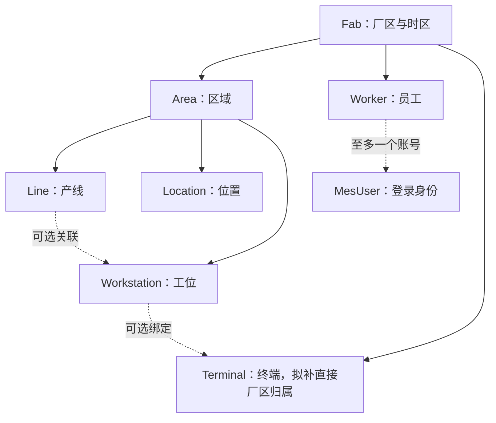

# OrganizationIdentityAccessControl 组织、身份与访问控制

日期：2026-11-11｜版本：v0.1｜状态：设计基线；01～04 首版代码已完成，验证范围见实现记录

实现进度、与设计的差异及运行方式以 [OrganizationIdentityAccessControl 实现记录](organization-identity-access-control-implementation.md) 为准。下文保留设计提出时的基础与模型差异，不将未执行验收标为通过。

关联：[功能目录](../development-process/07-fab-function-catalog.md) · [实现架构](../development-process/08-feature-implementation-architecture.md) · [接口与验收](organization-identity-access-control-api-and-acceptance.md)

## 1. 目标与范围

使用户通过 WebUI 登录，在授权厂区内维护组织及人员/终端，按角色获得业务入口；所有查询和写操作由服务端校验身份、权限与对象范围，并保留审计。

用户已确认：单企业单厂先落地，所有业务访问保留厂区校验；本地账号密码与同源 Cookie；管理员建号和重置密码、首登改密，不开放自行注册；角色授权与厂区范围，暂不开放个人直接授权。

| 功能 ID | 本轮设计深度 | 交付内容 |
| --- | --- | --- |
| OrganizationStructure | 完整 | 厂区、区域、产线、位置的查询、维护、启停与历史读取 |
| WorkforceAndTerminals | 完整 | 员工、工位、登录终端台账；员工与账号关联、操作场所上下文 |
| AccountsAndSessions | 完整 | 登录/退出、资料、改密/重置、锁定/解锁、停用/启用、首登改密、会话撤销 |
| RolesAndAuthorization | 完整 | 角色、权限目录、角色授权、用户角色、厂区范围、对象级授权 |
| ShiftsAndHandovers | 扩展边界 | 班次、生产日、跨午夜与双向交接的后续要求及模型缺口 |
| FederatedIdentityAndMultiFab | 扩展边界 | 双因素、SSO、多厂的启用条件；本期无对应配置入口 |

本文为设计基线，用户随后已授权编码；实际实现见上述记录。下面的页面、规则、默认参数和模型增补均为设计方案；现场密码策略、会话时长可在实现验收前配置调整，不把建议值记作用户已逐项确认。

## 2. 设计时基础与缺口（实现前快照）

核查来源：[组织实体](../../src/MESagent.Domain/Entities/Organization.cs)、[权限实体](../../src/MESagent.Domain/Entities/Security.cs)、[Identity 模型](../../src/MESagent.Infrastructure/Identity/MesUser.cs)、[DbContext](../../src/MESagent.Infrastructure/Persistence/MesDbContext.cs)、[实际字段字典](../development-process/05-database-catalog.md)。

| 已有结构 | 当前能确认的事实 | 尚需实现或增补 |
| --- | --- | --- |
| Fab/Area/Line/Location | 层级外键、启停、编码与 xmin；Location 挂在 Area 下 | 业务校验、停用影响分析、时区约束和 UI |
| Worker/Workstation/Terminal | 员工归 Fab；工位归 Area，可选 Line；终端可无工位 | 终端独立 FabId、同厂/同区域校验、账号与员工唯一绑定 |
| MesUser/Identity | 密码、锁定、并发/安全戳等基础字段，以及 IsActive/ForcePasswordChange | 登录服务、受限改密状态、会话台账与撤销、初始化流程 |
| Permission/RolePermission/UserFabScope | 权限及角色关系、用户厂区范围 | 权限种子、应用授权、范围解析、授权变更事务 |
| UserPermission | 仅用户—权限授予关系，无显式拒绝语义 | 本期不读入有效权限、不开放编辑；初始化发现遗留记录时报告人工核对 |
| MesRole | 标准 Identity 角色，没有业务启停字段 | 增加角色启停及受保护标识，配套并发控制 |
| Shift/ShiftHandover | 班次时刻、交接业务日与单方确认字段 | 双方确认、交接明细与历史班次规则，留待 ShiftsAndHandovers |
| AuditLog | 有用户、对象、动作、前后值、请求关联及来源 | 自动记录、脱敏、授权查询；匿名登录失败另需安全事件结构 |

现有 Identity 表不等于完整登录功能；Identity user_tokens 也不能直接当作活跃浏览器会话清单。

## 3. 角色、页面与默认职责

| 角色模板 | 默认用途 | OrganizationIdentityAccessControl 默认权限 |
| --- | --- | --- |
| 系统管理员 `SystemAdmin` | 组织和安全管理 | OrganizationIdentityAccessControl 组织/人员/账号/角色/范围/安全日志管理；不隐含生产放行、报废或工艺发布 |
| 操作员 `Operator` | 后续生产操作台 | 组织只读、本人资料与改密；生产动作由 F05 单独配置 |
| 工艺工程师 `ProcessEngineer` | 后续产品/路线/配方维护 | 组织只读、本人资料与改密 |
| 质量工程师 `QualityEngineer` | 后续检验与处置 | 组织只读、本人资料与改密 |
| 计划员 `Planner` | 后续工单与计划 | 组织只读、本人资料与改密 |
| 设备工程师 `EquipmentEngineer` | 后续设备与维护 | 组织只读、本人资料与改密；不因此得到终端或账号管理权限 |
| 只读用户 `Viewer` | 后续看板与追溯查询 | 组织只读、本人资料与改密；没有批量导出和人员名录权限 |

角色模板是初始建议，普通模板可调整或停用。SystemAdmin 为受保护角色，不允许删除、停用或修改其 OrganizationIdentityAccessControl 管理权限集合；成员可由另一管理员管理，仍须有部署厂区范围。生产授权应显式叠加对应业务角色。

| 页面/路由建议 | 主要操作与反馈 |
| --- | --- |
| `/login` | 用户名/密码；统一登录失败提示；提交节流；无注册和邮件找回入口 |
| `/account/change-password` | 首登受限模式与主动改密；显示密码规则；成功后重新登录 |
| `/account/profile` | 账号及员工身份只读、修改显示名；查看/退出会话 |
| `/settings/organization` | 厂区详情、区域树，区域下分别查看产线和位置；影响预览、启停、历史标识 |
| `/settings/workers` | 员工列表、关联账号、启停及影响提示 |
| `/settings/workstations` | 工位及区域/可选产线；关联终端，校验 Line 属于同 Area |
| `/settings/terminals` | 终端编号、部署厂区、工位绑定、最后联系时间和版本；不展示为物理机台 |
| `/settings/users` | 账号列表、状态、员工绑定、角色、厂区范围、解锁/重置/撤销会话；敏感操作单独确认 |
| `/settings/roles` | 角色列表、权限勾选、成员与变更影响；只展示已交付权限 |
| `/settings/security-events` | OrganizationIdentityAccessControl 审计与登录/会话安全事件；按时间、操作人、动作、结果筛选 |

列表提供关键字、启停/状态筛选和分页；详情保留停用对象入口。按钮不可用时显示业务原因。并发冲突后保留表单供比较，重新读取后再提交，不静默覆盖他人修改。

## 4. OrganizationStructure：组织结构与启停

### 4.1 对象与字段

位置与产线是 Area 下的不同对象，不把 Location 强行挂到 Line。工位也不等于设备；设备台账属于 F07。

| 对象 | 可维护字段 | 编码唯一范围 |
| --- | --- | --- |
| Fab | Code、Name、Description、Timezone、IsActive | 全实例 |
| Area | Code、Name、Description、FabId、IsActive | Fab 内 |
| Line | Code、Name、Description、AreaId、IsActive | Area 内 |
| Location | Code、Name、Description、AreaId、LocationType、IsActive | Area 内 |

设计统一 Code 为 1～64 位大写 ASCII 字母、数字、`-_.`，首字符字母或数字；输入去两端空白再大写，预检已有数据冲突后增加一致约束。Name 去空白后 1～200 字符，Description 最多 2,000 字符。LocationType 首期为受控枚举 `Storage/Buffer/Process/Other`，具体仓储功能由 F08 定义。现有字段长度不等于已经实施这些输入规则。

### 4.2 业务规则

1. 部署时显式配置唯一 `DeploymentFabId`。引导命令创建首个 Fab；正常 WebUI 只维护该厂，不开放新增第二厂。数据库有第二厂也不自动开放。
2. Code 与父归属创建后不允许普通编辑，以免历史对象被重新解释为另一组织。更名允许并审计；需要迁移组织归属时另立受控迁移用例。关联中的父节点必须属于部署厂且有效。
3. 所有主数据使用启停，不开放物理删除。引用历史保留原 ID；详情显示当前名称、编码和停用标识，更名轨迹通过审计查询，不宣称已有完整历史名称快照。
4. 停用前展示依赖摘要；提交时在事务内复核。存在启用的直接子对象、进行中的加工/占用或必须处理的未结业务时拒绝，返回阻塞项及可访问来源链接。暂不支持级联自动停用。
5. “有效”包括自身及必需父节点启用。停用后禁止新增绑定与新生产操作，历史只读仍按权限/厂区范围提供。后续业务写入必须重新检查组织有效性；不会自动终止已发生的加工。
6. 停用 Fab 时先处理其有效子对象；保留管理员登录及重新启用入口、既有范围与历史查询。Fab 停用不是撤销用户范围，也不是删除记录。
7. 启用子对象须先启用父对象。编号不因停用而释放，不能创建同编码新对象替换历史。

停用依赖按当前启用模块注册检查器；OrganizationIdentityAccessControl 首期至少检查组织子对象、员工绑定、工位终端和已有设备/载具/加工相关引用。后续模块上线时同步增加检查，不能把“没有 API”解释为“数据库没有未结记录”。依赖关系无法明确判断时返回需处理的引用，禁止猜测迁移或自动收尾。

新增绑定、启用子项与停用父项共用组织锁约定：在事务中按固定层级及 ID 顺序锁定相关父节点，再检查有效性和依赖、执行写入。仅对子记录使用 xmin 不能阻止“父项刚停用、另一事务又创建子项”的竞争；后续生产创建引用的用例也须遵守这一约定。

### 4.3 时区

Fab.Timezone 使用经过服务器校验的 IANA 时区标识；演示建议 `Asia/Shanghai`，由初始化配置确定。业务事件统一 UTC 存储，界面以 Fab 时区呈现，筛选的本地日期由服务端转为 UTC 区间。

Fab 创建后时区不开放普通编辑；变更需确认历史显示、生产日和班次影响后另行迁移。不能直接以浏览器本地时区代替 Fab 时区，也不能修改旧事件 UTC 时间来“修正显示”。

## 5. WorkforceAndTerminals：员工、工位与终端

| 对象 | 规则 |
| --- | --- |
| Worker | 编码在 Fab 内唯一；员工可以没有账号。一个员工至多绑定一个账号，停用账号也保留该绑定，解绑必须显式执行并审计 |
| MesUser.WorkerId | 可空；生产操作角色执行现场动作前必须绑定有效 Worker；管理员/只读用户可不绑定。员工所属厂必须在账号有效范围内 |
| Workstation | Area 必填，Line 可空；有 Line 时必须属于同一 Area；编码在 Area 内唯一，Area 归属创建后不改 |
| Terminal | 拟增必填 FabId；DeviceUuid 全实例唯一；Code 按 Fab 唯一；Workstation 可空，有绑定时同厂且工位有效 |
| 终端上下文 | 普通管理浏览器可没有终端；生产操作台后续要求登记终端及有效工位。TerminalId/DeviceUuid 是上下文标识，不是登录凭据 |

员工停用与其关联账号停用、会话撤销在同一事务完成；启用员工不自动恢复账号。存在关联账号时，操作者另须具备安全管理身份及 `security.users.manage`，不能借员工维护权限影响其它登录身份。若关联最后可用管理员或操作人本人，先由另一管理员处理；不允许通过员工停用绕过账号保护。

账号绑定员工时检查唯一占用、厂区和员工有效性。账号更换员工或终端换绑工位只影响未来操作；业务事实记录当次 WorkerId、TerminalId、WorkstationId，不能通过当前绑定反推旧履历。现有生产记录是否拥有这些快照/字段由相应模块补齐。

终端可以登记为“未分配工位”，仍因直接 FabId 受到范围限制；不能因 WorkstationId 为空被视为全局公开。停用终端/工位或重绑终端时撤销携带受影响终端上下文的会话，要求重新核对场所。不得改变旧操作日志中的场所。

前端在登录或操作台入口选择已授权终端并请求服务端校验绑定；允许手工选择意味着首版只能证明“记录的操作上下文”，不证明浏览器物理位置。设备证书、终端注册密钥和现场网络认证属于后续增强；界面不显示“已认证物理设备”的误导提示。

LastSeenAt 仅由成功认证的终端上下文请求限频更新，AppVersion 为客户端报告信息，均不充当安全证据。多人共用终端时必须退出再由下一人登录，禁止共享操作员账号。

## 6. AccountsAndSessions：账号与会话

### 6.1 建号与生命周期

由具有用户管理权限的管理员输入唯一用户名、显示名、可选员工、初始角色、部署厂区范围和临时密码。用户名规范化交给 Identity，同时限制为 3～64 位 ASCII 字母、数字、`-_.@`，不允许以停用释放用户名；用户名建号后不可改。

创建账号、绑定角色/范围、设置 `ForcePasswordChange=true` 和审计须同事务完成。没有范围或角色时可以保存为未配置账号，但不能访问业务；UI 必须明确提示。AccountType 固定 `Human`，不在此入口创建服务身份。

临时密码由管理员输入并线下安全交付，接口只接收不返回、不写日志；不开放邮件找回和公开注册。管理员也看不到既有密码。后续若需要自动发送邀请，另定通知渠道与一次性令牌流程。

| 状态/条件 | 登录结果 | 可用动作 |
| --- | --- | --- |
| IsActive=false | 拒绝 | 由管理员启用；不自动撤销 ForcePasswordChange |
| LockoutEnd 尚未到期 | 拒绝新登录 | 等待到期或管理员解锁；管理员手动锁定另撤销现有会话 |
| 密码正确且需改密 | 创建短时受限会话 | 获取最小本人信息、改密、获取防伪令牌、退出；禁止任何业务读写 |
| 密码正确且正常 | 创建普通会话 | 仍须逐用例检查角色、权限、厂区和员工/终端条件 |
| 无有效角色或范围 | 可完成账号维护登录 | 仅本人资料、改密、退出；业务页面显示未配置授权 |

不要把以上状态拼成单一可任意编辑枚举；Identity 锁定、IsActive、ForcePasswordChange 和会话有效性各有独立语义。

### 6.2 登录与防伪

采用 Identity 的密码验证/哈希、UserManager/SignInManager 能力及应用自定义入口，不直接暴露自动注册端点。Cookie 采用 `HttpOnly`、`Secure`、`SameSite=Lax`、Host-only 和 `/` 路径；部署使用 HTTPS，认证 Cookie 不可由 JavaScript 读取，不把登录票据写入 localStorage。

SPA 先获取请求防伪令牌，登录、退出以及所有 Cookie 认证写请求均通过请求头提交并校验；身份切换后重新获取令牌。GET 不写业务数据，SameSite 不替代防伪校验。实现依据为 [ASP.NET Core 防伪文档](https://learn.microsoft.com/en-us/aspnet/core/security/anti-request-forgery?view=aspnetcore-10.0)，具体中间件/过滤器配置须针对锁定的 .NET 版本验证。

建议初始配置如下，均需配置化：

| 项目 | 建议值/行为 |
| --- | --- |
| 密码 | 最少 12、最多 128 字符；不截断、不 trim；允许长口令；由 Identity 配置统一验证 |
| 自动锁定 | 连续 5 次密码错误锁定 15 分钟；显式启用失败计数；成功后按 Identity 行为复位 |
| 登录限流 | 按可信代理解析后的来源 IP 与规范化账号联合限流；超限 429，避免只靠账号锁定 |
| 普通会话 | 空闲 30 分钟、绝对 12 小时；后台轮询/心跳不延长空闲计时；不启用“记住我” |
| 受限改密会话 | 10 分钟，不滑动续期 |
| 管理员手动锁定 | 默认 15 分钟，可指定到期时间；长期禁止使用应选停用 |

密码错误、未知账号、停用或锁定在匿名登录页统一提示“无法登录，请检查凭据或联系管理员”，详细原因仅进入受限安全日志。Identity 的配置与安全戳机制参考 [Identity 配置文档](https://learn.microsoft.com/en-us/aspnet/core/security/authentication/identity-configuration?view=aspnetcore-10.0)；上述策略值是本项目建议，并非框架默认承诺。

### 6.3 改密、重置与资料

- 本人改密要求当前密码和新密码；首登改密也校验临时密码。成功后清除 ForcePasswordChange、轮换安全戳并撤销全部会话，用户使用新密码重新登录。新密码不得与当前相同。
- 管理员重置要求用户管理权限、目标版本及原因，设置新的临时密码和 ForcePasswordChange，撤销目标全部会话。重置不隐式启用停用账号或解除锁定；解锁为独立动作。
- 解锁清除锁定截止和失败计数，不更改密码、不恢复被撤销会话；手动锁定与停用均撤销现有会话。
- 本人资料只可修改显示名；用户名、员工绑定、角色、厂区范围、账号类型和启停只通过管理入口。员工法定/业务姓名由员工管理维护。
- 登录/密码请求与响应不进入通用 Body 日志或 CommandReceipt；前端对含凭据请求禁用自动重试。响应丢失时尝试新密码登录或联系管理员重新重置，不读取旧明文密码。

### 6.4 会话有效性与撤权

新增服务端 `UserSession` 台账，Cookie 携带受保护的 UserId、SessionId 和安全戳引用。每个请求检查会话未撤销、未超时、用户有效、安全戳匹配，以及受限改密模式。有效权限每个用例从数据库读取，首版不缓存长寿命角色/范围快照。

退出撤销当前 SessionId 并清除 Cookie；“退出所有会话”、改密、重置、停用、管理员手动锁定撤销全部会话。自动登录失败锁定只阻止新登录，不主动踢掉已有合法会话，避免匿名攻击者反复踢人。

修改用户角色/范围/员工绑定、停用角色或调整角色权限时，撤销全部受影响用户会话并轮换安全戳。账号角色/范围关系变化须推进账号并发版本，角色权限变化须推进角色并发版本；不依赖 Identity 默认周期检查实现及时失效。

“生效”定义为变更事务提交后开始授权检查的下一次请求被拒绝或按新权限执行；已经通过授权并开始处理的在途请求可能完成，不宣称能回滚已提交业务。前端收到 401 清空用户缓存并返回登录；未来实时连接同步撤销订阅。数据库不可用时认证校验失败关闭访问，不降级信任旧权限。

首次成功登录更新 LastLoginAt；会话记录创建、活动和结束原因。列表仅展示必要终端、时间和简化来源信息，不返回 Cookie、安全戳或密码字段。

空闲计时由服务端明确的交互端点策略推进，轮询、CSRF 获取和终端心跳不推进；实现时逐端点标注并测试。该计时衡量系统请求活动，不宣称证明真人持续在场。

## 7. RolesAndAuthorization：角色、权限与对象范围

### 7.1 权限目录

Permission.Code 为代码定义的稳定标识，部署幂等初始化。WebUI 只选择已交付权限，不能新建任意字符串，也不支持 `*` 通配或客户端声明授予。权限停用从代码/受控迁移处理，未实现业务权限不提前作为可用功能展示。

| 权限代码 | 用途 |
| --- | --- |
| `org.structure.read` / `org.structure.manage` | 厂区、区域、产线、位置查询 / 创建、修改、启停（Fab 创建限引导） |
| `org.workers.read` / `org.workers.manage` | 员工查询 / 维护、启停 |
| `org.workstations.read` / `org.workstations.manage` | 工位查询 / 维护、启停 |
| `org.terminals.read` / `org.terminals.manage` | 终端查询 / 维护、绑定、启停 |
| `security.users.read` / `security.users.manage` | 账号管理列表 / 建号、资料、员工绑定、锁定、启停 |
| `security.users.reset-password` | 管理员重置密码 |
| `security.sessions.revoke` | 管理员查看并撤销目标会话 |
| `security.roles.read` / `security.roles.manage` | 角色/权限目录查询 / 角色维护及权限集合变更 |
| `security.assignments.manage` | 用户角色、厂区范围变更 |
| `security.audit.read` | OrganizationIdentityAccessControl 业务审计及安全事件查询 |

manage 不隐式包含 read，角色编辑器提示配套授权但两者分别保存；管理员种子同时授予需要的读写权限。普通本人资料、本人会话和改密通过“已认证且目标是本人”的专门策略，不要求管理权限；受限改密会话仍仅允许 §6.1 的白名单。

本期不提供组织/人员/账号批量导出。后续导出必须新增对应 `*.export` 权限并复用读取范围，不能用 read 自动获得批量导出能力。

### 7.2 授权算法

有效动作权限 = 用户绑定的启用角色所授予的启用 Permission 的并集；不包含 UserPermission、任意 RoleClaim/UserClaim 或客户端菜单信息。默认拒绝，角色名不是绕过权限检查的后门。

一次业务动作至少同时满足：有效会话与账号 → 非受限改密 → 有动作权限 → 有部署厂区范围 → 目标及全部关联对象在允许范围 → 业务状态/员工/场所条件符合。只读历史不要求主数据启用，但仍要求权限与范围。

| 对象 | 范围解析规则 |
| --- | --- |
| Fab、Area、Worker、拟补后的 Terminal | 自身 FabId（Fab 使用自身 ID）必须为部署厂且在 UserFabScope 内 |
| Line、Location、Workstation | 沿 Area.FabId；工位的 Line 必须在同 Area |
| 员工关联账号、终端上下文 | 同时验证员工/账号范围或终端/工位范围；关联不能扩大权限 |
| 用户、角色、权限目录、安全事件 | 单厂部署中的实例级安全管理资源，仅受保护 SystemAdmin 且具相应管理权限和部署范围可管理/查询；本人资料例外 |
| 后续业务对象 | 按架构文档与对应模块定义解析；无法解析时拒绝，禁止默认全局 |

账号未分配范围仍可被 SystemAdmin 查到并配置。组织主数据列表先过滤范围再分页统计；跨厂对象详情按 404 处理，动作权限缺失按 403 处理。错误和依赖列表也不能暴露越权对象名称与数量。

本期安全管理权限仅允许绑定受保护 SystemAdmin 角色；普通自定义角色不能通过勾选这些权限形成第二条提权路径。管理员可管理普通角色的已交付业务权限，但普通角色维护权限本身不能下放。将来委托厂级管理员时另定可授予权限集合与管理对象范围。

### 7.3 防止管理员锁死与授权漂移

至少保留一个启用、未处于锁定期、拥有部署厂区范围的 SystemAdmin。涉及管理员成员、范围、锁定、停用及关联员工停用时，在事务内通过部署级管理锁串行校验这个不变量；不能只在 UI 查询人数。

禁止管理员通过常规页面移除自己的管理员身份/部署范围、停用或手动锁定自己；由另一管理员执行。本人退出、改密和退出全部会话不受此限制。匿名登录失败可能使管理员自动锁定，等待到期或通过受控本地恢复命令解锁；恢复命令需宿主机管理权限、记录原因与审计，不提供远程匿名后门。

角色授权更改界面显示新增/移除权限及受影响人数；服务端同事务更新关系、并发版本、撤销会话及审计。权限种子按稳定 Code 同步定义，不能在每次启动时覆盖用户配置的普通角色权限和成员。

## 8. 数据模型调整建议

以下记录设计时的增量迁移候选；当前已实施部分见实现记录与第 4 条迁移。新增表会改变当前 114 张业务表的数量，实施后再更新字典与统计。

| 调整 | 最小结构/约束 | 原因与迁移处理 |
| --- | --- | --- |
| Terminal 增加 FabId | 必填 FK；`(FabId, Code)` 唯一；保留 DeviceUuid 全局唯一；工位须同厂 | 已绑定终端由工位回填；未绑定终端必须显式指定，禁止猜厂；检查重复 Code |
| MesUser.WorkerId 唯一绑定 | 非空值部分唯一索引；员工有效/同厂由应用检查 | 迁移前列出重复绑定，人工解决后建索引，不擅自删账号 |
| MesRole 元数据 | `IsActive`、`IsSystem`；使用现有 ConcurrencyStamp | 现有角色默认有效；按受控种子识别保护角色，禁止仅因同名把未知角色升级 |
| `security.user_sessions` 新表 | Id、UserId、CreatedAt、LastActivityAt、IdleExpiresAt、AbsoluteExpiresAt、RevokedAt、RevokeReason、Mode、可空 TerminalId、安全戳快照、xmin | 不存 Cookie 明文；UserId/活跃会话索引；时间顺序 CHECK；安全戳快照仅内部使用 |
| `security.security_events` 新表 | Id、OccurredAt、可空 UserId、EventType、Outcome、CorrelationId、受限来源信息、可空 TerminalId/SessionId | 记录匿名登录失败、限流、会话失效；追加只读，避免拿伪造用户 ID 填 AuditLog |
| 组织规范化与关联约束 | Code 格式检查；工位 Line/Area 一致性；终端 Fab/工位一致性 | 应用校验配合数据库复合约束或专用迁移保护；精确 DDL 在实现时审查 |
| 授权关系版本 | 变更用户角色/范围时更新 MesUser.ConcurrencyStamp；变更角色权限时更新 MesRole.ConcurrencyStamp | 现有关系行有 xmin，但不足以代表整个授权集合版本；版本推进与关系变化原子提交 |

Identity 安全戳用于认证失效，ConcurrencyStamp 用于编辑冲突，两者用途不同，不替换为一个字段。密码哈希等敏感字段仅由 Identity 管理。

业务审计记录操作者、动作、目标、必要的前后差异、原因、UTC 时间及 CorrelationId；凭据、令牌、Cookie、密码哈希和安全戳均排除。账号/授权/组织成功写入与审计同事务，审计失败则业务回滚。匿名失败事件单独落库，不能随被拒绝的业务事务回滚；日志不可用时仍拒绝失败登录并写受限运行告警。

安全事件留存建议先配置为 90 天，待部署要求确认；业务审计不在本期自动清理。账号用户名、IP、UserAgent 不无界记录，限制长度、控制日志读取并避免完整请求体。普通角色只能看必要组织信息，安全事件只供 SystemAdmin。

## 9. 初始化与开发分工

初始化顺序：应用增量迁移 → 显式创建/选定部署 Fab → 幂等同步权限定义和角色模板 → 创建首个管理员/绑定范围 → 强制首登改密 → 进入组织维护。密码通过交互或部署密钥输入，不出现在命令行参数、Git、种子数据或文档中；已有管理员时拒绝重复引导。

| 层/模块 | OrganizationIdentityAccessControl 责任 |
| --- | --- |
| Application/Organization | 组织用例、归属/启停规则、影响查询、员工/工位/终端上下文 |
| Application/AccessControl | 账号、角色、范围、有效权限、会话策略接口；统一对象授权 |
| Domain | 组织关系与可执行性约束；不引用 Identity 框架类型 |
| Infrastructure | Identity 适配、数据库事务/约束、会话持久化、安全事件、审计查询 |
| API | 同源 Cookie、防伪、限流、HTTP DTO、状态码、OpenAPI、请求关联 |
| WebUI | 页面/表单、授权入口、状态/错误、密码受限流程、会话失效与缓存清理 |

实施建议分四步：先补模型与真实库约束测试；再建登录/会话/授权管线；接入组织与安全管理 API；最后完成 WebUI 和 Docker 端到端验收。不得以静态管理页或模拟登录替代验收。

## 10. ShiftsAndHandovers/06 扩展边界

### ShiftsAndHandovers：班次、生产日与交接

未来需明确班次有效星期、节假日/例外日历、厂级或产线级范围与重叠策略。建议跨午夜班次的生产日为 Fab 本地开始日期，例如 11 月 11 日 20:00 至次日 08:00 属于 11 月 11 日；该口径待启用时确认。遇夏令时的重复/缺失时刻必须明确解析规则，生成的实际 UTC 起止写入交接事实。

现有 Shift 只是班次定义，不是完整生产日历；ShiftHandover 只有 ConfirmedById/ConfirmedAt，不能支撑双方确认。启用前须补交班/接班人员与确认时间、状态、未完工 Lot/停机/异常的来源 ID 和当时摘要，以及受控更正历史。

当前 `(ShiftId, BusinessDate)` 唯一键不能支持同一班次同一天多个产线分别交接；需先确定实例粒度，再调整唯一键及有效版本。双方确认应来自各自有效身份，冻结交接快照，不能用当前 WIP 查询结果伪装过去交接内容。

本期无班次排班、交接单页面和统计；不因此阻塞 组织结构、人员与场所、账号会话及角色权限。若现场试点必须按班交接，应单独前移并完善验收。

### FederatedIdentityAndMultiFab：双因素、SSO、多厂

| 扩展 | 启用前需确认与验证 |
| --- | --- |
| 双因素 | 组织强制范围、注册/恢复/丢失设备流程、恢复码保管与管理员恢复审计；Identity 有基础字段不代表流程完成 |
| 企业 SSO | IdP 与协议、不可变外部主体映射、账号开通/离职停用、角色权威源、注销/会话撤销；不能仅凭相同邮箱自动合并账号 |
| 多厂 | 用户—角色—Fab 的授权关系、工艺共享对象归属、账号管理范围、终端归属、跨厂操作与全部读写/导出/通知隔离测试 |

以上只列边界，不确定供应商、不配置 IdP、不实现第二认证通道；未启用双因素或企业 SSO 时 UI 不宣称已具备对应安全能力。

## 11. 完成标准与后续

组织结构、人员与场所、账号会话及角色权限 的规则、模型、接口与真实页面全部通过 [接口与验收清单](organization-identity-access-control-api-and-acceptance.md) 后才可标为“已实现”。ShiftsAndHandovers/06 继续标为扩展，整体 OrganizationIdentityAccessControl 不因此宣称全部六项交付。

后续编码前根据本文生成增量迁移和任务，核查实际数据中的重复员工绑定、未归属终端及编码冲突；不自动修复未知业务数据。具体现场岗位、终端可信度、生产动作的人员资格要求在相应生产模块中继续确认。
